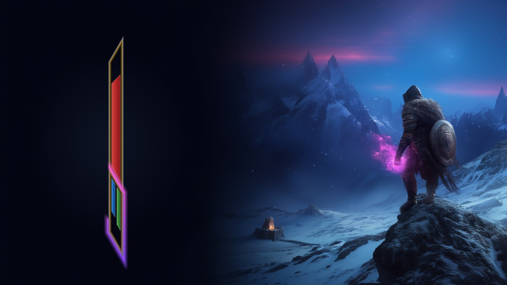

# Minimal Vitals

A small health / magicka / stamina widget for Skyrim SE / AE, drawn through SKSE Menu Framework.
Thin-line frame, fixed size at every level, current values beside it.

**Download: [Nexus Mods](https://www.nexusmods.com/skyrimspecialedition/mods/195787)**



## Features

- Health fills up from the divider; magicka and stamina fill down, side by side
- Bars never grow with level; only the numbers change
- Glow round the lower box while a spell charges; pulses when fully charged or channelling
- Glow down the frame while your shout recovers
- Thin dark green horse stamina line down the right side while riding (can be turned off)
- Rotate it 90, 180 or 270 degrees; the numbers stay upright
- Hides in menus, loading screens, with a hotkey, with Photo Mode Hide UI, and whenever the compass is hidden
- Optional dark backing behind the bars (off = clear)
- Position, size, rotation, opacity, line width and glows set in SKSE Menu Framework, with a live preview

## Requirements

- SKSE
- Address Library for SKSE Plugins
- SKSE Menu Framework

Works on SE 1.5.97, AE 1.6.x and 1.7.x (use the Address Library that matches your game).

TrueHUD is not required. Minimal Vitals does not hide the vanilla bars itself; use TrueHUD, Immersive HUD or any HUD mod that hides them.

Full user notes: [Minimal VitalsREADME.md](Minimal%20VitalsREADME.md) (the file shipped with the mod).

## Building

Built against [CommonLibSSE-NG](https://github.com/alandtse/CommonLibSSE-NG) **v9.1.0** (alandtse), pinned as the
submodule `extern/CommonLibSSE-NG`. That version reads the 1.7.x Address Library (format 5) and marks the DLL as
Address Library v5 compatible, so one DLL runs on SE 1.5.97, AE 1.6.x, 1.7.x and VR.

```bat
git clone https://github.com/StinkyPumpkin/Minimal-Vitals.git
cd Minimal-Vitals
git submodule update --init --recursive --depth 1
build.bat
```

- Visual Studio 2022 (C++ workload, MSVC 14.44), CMake 3.21+, Ninja
- vcpkg (manifest mode; `build.bat` sets `VCPKG_ROOT=C:\vcpkg`, edit it and the Visual Studio path for your setup)
- Output: `build/ng/release/MinimalVitals.dll`. The first build compiles CommonLibSSE-NG itself.
- Optional: set `SKYRIM_MODS_FOLDER` to your MO2 `mods` folder and the build copies the DLL into a mod folder there.

Release layout: `SKSE/Plugins/MinimalVitals.dll`, `SKSE/Plugins/Fonts/MinimalVitals.ttf` (from `art/`),
`Interface/MinimalVitals/grain.dds` (from `art/`, made by `tools/make_grain.py`).

## Credits

- zax: [Casting Bar](https://github.com/zax-ftw/CastingBar) (Apache-2.0), the cast timing approach
- Outfit font: The Outfit Project Authors, SIL Open Font License 1.1 (`art/Minimal Vitals Font OFL.txt`)
- CommonLibSSE-NG, SKSE Menu Framework

## License

GPL-3.0 (`LICENSE`). Free and open: modify, fork and reupload as you like.
